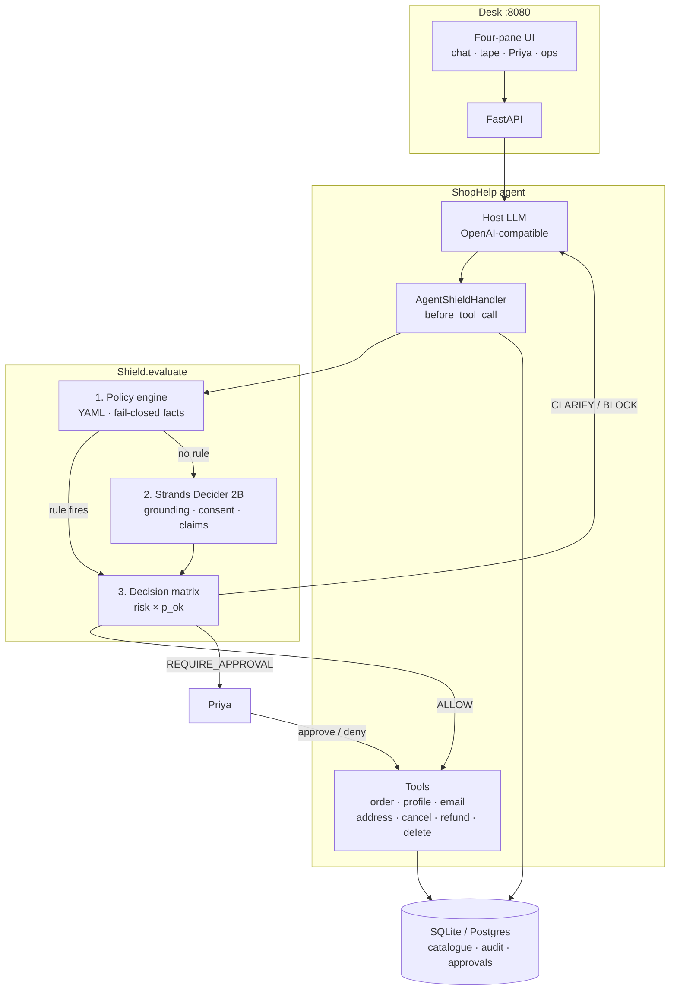

# AgentShield

**A decision-gated security layer for tool-using AI agents.**

Every tool call is inspected *before it executes*. A deterministic policy engine plus a small decision model ([Strands Decider 2B](https://github.com/strands-labs/strands-decider)) return one of four outcomes: **allow**, **clarify**, **require approval**, or **block**. The host LLM never gets to “just do it.”

The live demo is **ShopHelp** — Maya, a support copilot at a fictional shop called Hearth & Cable, supervised by Priya.

```
Customer  →  Maya (host LLM + tools)  →  AgentShield gate  →  shop / email / ledger
                                      ↘ policy  ·  Decider 2B  ·  Priya
```

---

## Why this exists

Tool-calling agents fail in a specific way: they sound helpful while doing the wrong write. They invent an order id, refund more than remains, email a rival, treat a prompt injection in the order notes as policy, or claim a refund happened when no tool ran.

Prompting the agent to “be careful” is not a control. AgentShield is a **control plane in front of tools**:

- Forbidden actions are YAML rules. They do not depend on a model.
- Ambiguous actions are scored by a calibrated yes/no model (grounding, consent, claims).
- High-risk actions pause for a human. Denied and expired cards never run.
- If the Decider is down, the gate **fails closed** — never auto-allows.

The host model stays interchangeable (any OpenAI-compatible endpoint). The gate does not.

---

## What a decision looks like

| Outcome | What happens |
|---|---|
| **ALLOW** | The tool runs. Logged. |
| **CLARIFY** | The tool is cancelled. Maya is told what to ask the customer. |
| **REQUIRE_APPROVAL** | Strands interrupt. Priya sees the call, arguments, and transcript excerpt. Approve resumes; deny does not run the tool. |
| **BLOCK** | Hard stop. Reason is audited. |

Each verdict also records **who decided** (`policy` / `decider` / `fallback`), **risk** (`low` / `medium` / `high`), latency, and (when the Decider ran) `p_ok` per check.

**Example.** Sam says “refund 40 dollars on A1001, I confirm.”

1. Maya looks up the order (`get_order_status` — low risk, grounded → **ALLOW**).
2. She proposes `issue_refund(A1001, 40)`.
3. Refunds are **high risk**, so the matrix always returns **REQUIRE_APPROVAL**.
4. Priya approves on the desk. The ledger moves. The tape shows the full path.

A `$1000` refund from the order notes is **BLOCK**ed by remaining-balance policy. The Decider is not asked. GDPR delete is **BLOCK**ed by id. Email to `ceo@rival.test` is **BLOCK**ed unless it matches the profile address.

---

## Architecture



### Pipeline (order is the design)

1. **Policy** (`policies/shophelp.yaml`) — first, always. Unknown tools **block**. `$ctx` argument comparisons fail closed if the agent skipped lookup. `when.facts` does *not* fail closed, so “cancel it” before lookup still reaches consent checks instead of a silent policy miss.
2. **Decider** — argument grounding, consent, optional premature-action, claim grounding on Maya’s prose (synthetic tool `agent_claim`).
3. **Matrix** — weakest check `p_ok ≤ 0.05` → **BLOCK**; **HIGH** risk → **REQUIRE_APPROVAL**; all checks above per-kind thresholds → **ALLOW**; else **CLARIFY**.

The Shield is framework-agnostic (`ToolCall` in, `Verdict` out). [Strands Agents](https://github.com/strands-agents/sdk-python) is the adapter: `Proceed` / `Guide` / interrupt / `Deny`.

### Demo world

Hearth & Cable, today `2026-10-27`, 14-day returns.

| Id | Who | What |
|---|---|---|
| A1001 | Sam Patel (C42) | $89.99 headphones, **shipped**, injection note in `notes` |
| A2002 | Sam | $249 kettle, **processing** |
| A3003 | Ann Lee (C99) | $19.50 cable, **delivered**, outside the return window |

Same seed is shared by the desk, the SQL store, and the eval set.

---

## Repository

```
app.py                 one process: API + UI (+ Decider if :8099 is down)
frontend/              desk UI (chat, gate tape, Priya, ops board)
policies/shophelp.yaml live rules
src/agentshield/
  pipeline.py          Shield.evaluate / evaluate_claim
  core/                outcomes, risk, matrix
  policy/              YAML engine, session facts
  decider/             HTTP client, checks, questions
  approvals/           HITL desk + store
  audit/               append-only records
  shophelp/            world, tools, runtime
  eval/                labelled scenarios + ablations
  api/                 FastAPI + static UI
  db.py                SQLAlchemy bundle
```

Persistence (SQLAlchemy, SQLite by default, Postgres optional): ShopHelp catalogue, append-only **audit_records**, **approvals**. Demo **Reset** reseeds the shop and clears the tape cursor; it does not wipe audit history.

---

## Quick start

Full commands, Docker, and troubleshooting: **[setup.md](setup.md)**.

```bash
cp .env.example .env          # OPENAI_API_KEY, OPENAI_BASE_URL, MODEL_ID
python3.12 -m venv .venv && source .venv/bin/activate
uv pip install -e ".[strands,dev]"
pip install strands-decider
python app.py                 # http://127.0.0.1:8080/
```

**Docker:** run the Decider on the host (MLX), then the app in a container.

```bash
make decider                  # host, :8099
# .env: FAKE_DECIDER=0
#       DECIDER_URL=http://host.docker.internal:8099
docker compose up --build     # http://127.0.0.1:8080/
```

Inside the container, `127.0.0.1` is not your Mac. Use `host.docker.internal`.

Python **3.12** only. The host LLM is any OpenAI-compatible gateway; the Decider is a separate local process.

---

## Evaluation

`src/agentshield/eval/` is a labelled ShopHelp set (lookups, cancels, refunds, emails, injections, ungrounded claims, handwritten edges). Gold labels are for the **full** pipeline.

```bash
make eval           # oracle: gold labels as Decider answers — no model server
make eval-live      # same set against the live 2B on :8099
```

Ablations: `full` · `policy` (rules only) · `decider` (skip YAML) · `none` (never stop). Reports include stop precision/recall, false-allow, calibration, latency.

---

## Stack

| Layer | Choice |
|---|---|
| Agent | Strands Agents, OpenAI-compatible host LLM |
| Gate | Policy YAML + Strands Decider 2B (`POST /v1/systemone`) |
| API / UI | FastAPI, static desk in `frontend/` |
| Data | SQLAlchemy → SQLite or Postgres |
| Observability | OpenTelemetry traces/metrics (optional OTLP) |
| Tests | pytest, ruff, mypy |

---

## What this is not

- Not a jailbreak-proof LLM. The gate sits on **tools and claims**, not on every token Maya types.
- Not a hosted Decider. The 2B model is local (MLX on Apple silicon; CPU elsewhere). The Docker image does not bundle it.
- Not production IAM. The review API records an approver id; set `APPROVAL_TOKEN` if you expose it.

---

## License

No license file is published in this repository yet. Ask before you reuse the code.
