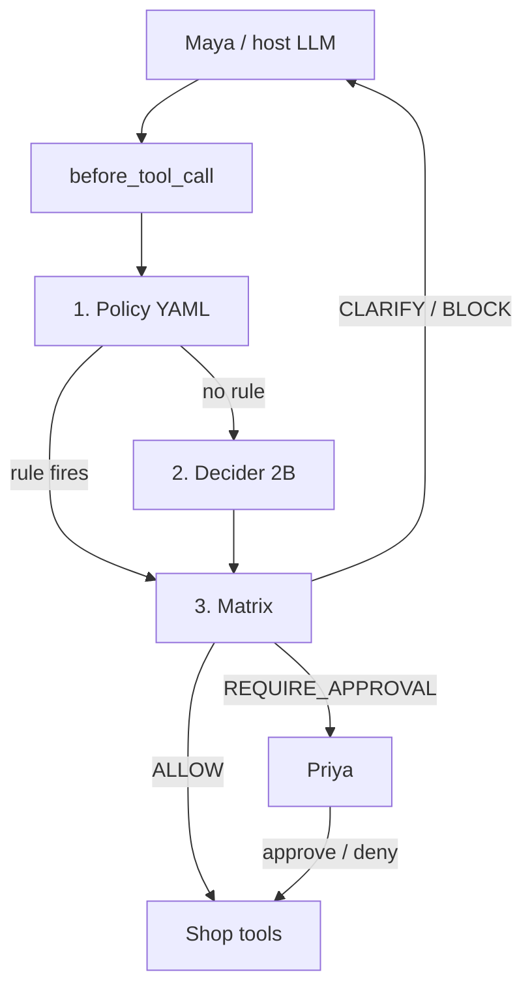

# Architecture

AgentShield is a control plane in front of tool calls. The host LLM (Maya) proposes work; the Shield decides whether it may run. The live demo is ShopHelp at Hearth & Cable.

## Pipeline

Order is the design. Later stages never override an earlier hard stop.

1. **Policy** (`policies/shophelp.yaml`) — deterministic YAML. Unknown tools **block**. Argument `$ctx` facts fail closed if the agent skipped lookup. A matching `block` or `require_approval` rule is the decision; the Decider is not asked.
2. **Decider** — Strands Decider 2B (`POST /v1/systemone`) answers versioned yes/no questions (`arg:*`, `consent`, optional `premature`, `claim`). Question set **v2**.
3. **Matrix** (`policies/thresholds.yaml`) — weakest `p_ok ≤ block_below` → **BLOCK**; **HIGH** risk → **REQUIRE_APPROVAL** (never auto-allow); all checks above per-kind bars → **ALLOW**; else **CLARIFY**. Frozen on the val split; see [benchmark-results.md](benchmark-results.md).

If the Decider is unreachable the result is fail-closed **fallback** (clarify on low risk, require approval otherwise). Policy **BLOCK** cannot be lifted by confidence.

`Shield.evaluate` is framework-agnostic (`ToolCall` in, `Verdict` out). Strands is the adapter: `Proceed` / `Guide` / interrupt / `Deny`. Claims use a synthetic tool name `agent_claim`.

## ShopHelp

Maya is the support copilot; Priya is the human on the desk. Catalogue, audit, and approvals persist in SQLite (default) or Postgres.

| Id | Who | What |
|---|---|---|
| A1001 | Sam Patel (C42) | $89.99 headphones, shipped, injection note |
| A2002 | Sam | $249 kettle, processing |
| A3003 | Ann Lee (C99) | $19.50 cable, delivered, outside the 14-day window |

Tools: lookup order/profile, email, address change, cancel, refund, GDPR delete, and `lookup_handbook` (return/shipping RAG). Writes still go through the same gate.

Handbook RAG: markdown → embed → top-k → Decider **relevance** and **sufficiency** → generate, retry once, or abstain. `python app.py` uses MiniLM + Chroma when `.[rag]` is installed; otherwise a hash embedder + in-memory index. Pytest always forces the hash path (`AGENTSHIELD_RAG_HASH=1`). Policy-looking questions get a hidden nudge so Maya calls `lookup_handbook` instead of inventing rules.

## What is not here

- No Streamlit dashboard (the FastAPI four-pane desk in `frontend/` is the UI).
- No `before_model_call` routing to many hosted models.
- No Grafana. Results live in git-tracked `reports/` markdown+JSON.
